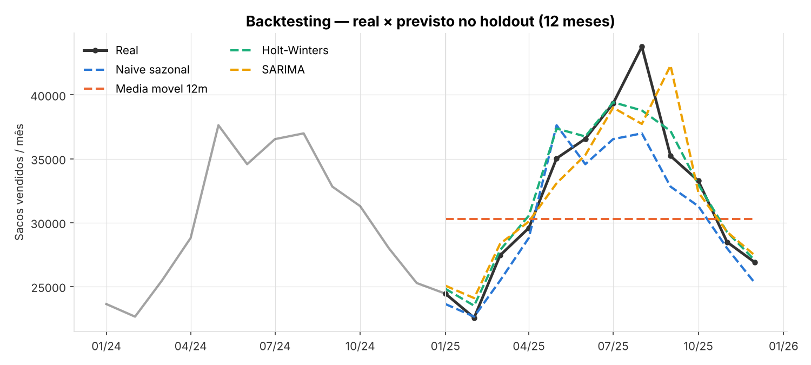
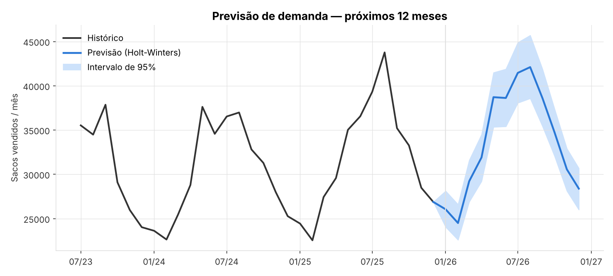

# 📈 Previsão de Demanda com Séries Temporais

Pipeline em Python que **prevê a demanda mensal dos próximos 12 meses** a partir de 5 anos de histórico de vendas, comparando 4 modelos de séries temporais com backtesting e métricas objetivas.

> ⚠️ Todos os dados são **100% fictícios**, gerados pelo próprio repositório (vendas de cimento de uma rede fictícia de lojas de materiais de construção). Nenhum dado real foi utilizado.

## 🎯 O problema

Quanto comprar? Quanto estocar? Errar a previsão de demanda para cima gera estoque parado e capital imobilizado; errar para baixo gera ruptura e venda perdida. Este projeto mostra o ciclo completo de uma previsão de demanda bem feita: **dados → modelos concorrentes → backtesting → previsão com intervalo de confiança**.

## ⚙️ O que o pipeline faz

```
Vendas diárias (5 anos)
      │
      ▼
1. AGREGAÇÃO ───── consolida as vendas diárias em série mensal (60 meses)
      ▼
2. BACKTESTING ─── treina 4 modelos nos primeiros 48 meses e avalia
      │            nos últimos 12 (holdout):
      │            • Naive sazonal (baseline)
      │            • Média móvel 12m (baseline)
      │            • Holt-Winters (suavização exponencial tripla)
      │            • SARIMA (1,1,1)(1,1,1)12
      ▼
3. SELEÇÃO ─────── compara MAE, RMSE e MAPE e elege o melhor modelo
      ▼
4. PREVISÃO ────── reajusta o vencedor na série completa e projeta
      │            12 meses com intervalo de confiança de 95%
      ▼
5. SAÍDAS ──────── gráficos (PNG), CSV e Excel com previsão e métricas
```

### Resultado do backtesting

| Modelo | MAE | RMSE | MAPE |
|---|---|---|---|
| **Holt-Winters** | **1.124** | **1.758** | **3,25%** |
| SARIMA | 1.874 | 2.855 | 5,47% |
| Naive sazonal | 2.025 | 2.617 | 5,79% |
| Média móvel 12m | 5.316 | 6.295 | 16,46% |

O Holt-Winters venceu com **MAPE de 3,25%** — ganho de 2,5 p.p. sobre o baseline. A média móvel, que ignora sazonalidade, erra 5x mais: é exatamente o papel dos baselines, mostrar quanto a modelagem estruturada agrega.

## 📊 Gráficos gerados

**Backtesting — real × previsto no holdout:**



**Previsão final com intervalo de confiança:**



O pipeline também gera o histórico mensal completo e a **decomposição da série** (tendência + sazonalidade + resíduo) em `graficos/`.

## 🚀 Como executar

```bash
# 1. Instale as dependências
pip install -r requirements.txt

# 2. Gere os dados fictícios de vendas
python src/gerar_dados.py

# 3. Execute o pipeline de previsão
python src/pipeline.py
```

Saídas em `dados/`: `previsao_12m.csv` (previsão com limites do intervalo) e `resultado_previsao.xlsx` (histórico, métricas e previsão em abas).

## 📁 Estrutura do projeto

```
previsao-demanda/
├── src/
│   ├── gerar_dados.py   # série sintética: tendência + sazonalidade + promoções + ruído
│   ├── modelos.py       # naive sazonal, média móvel, Holt-Winters, SARIMA
│   ├── avaliacao.py     # backtesting com holdout + MAE/RMSE/MAPE
│   ├── graficos.py      # gráficos em matplotlib (paleta acessível)
│   └── pipeline.py      # orquestra: agrega → compara → seleciona → projeta
├── dados/               # série gerada + previsões exportadas
├── graficos/            # PNGs gerados pelo pipeline
├── requirements.txt
└── README.md
```

## 💡 Decisões de projeto

- **Baselines antes de modelos**: um modelo só se justifica se superar o naive sazonal. A comparação está no centro do pipeline, não escondida.
- **Backtesting honesto**: as métricas são calculadas em 12 meses que o modelo nunca viu — não em dados de treino.
- **O vencedor é escolhido pelos dados**: a previsão final usa o modelo com melhor MAPE no holdout, não um favorito fixado no código.
- **Intervalo de confiança sempre**: previsão pontual sem incerteza é meia resposta. Para o Holt-Winters, que não tem intervalo analítico no statsmodels, o intervalo é estimado por **simulação de 1.000 trajetórias**.
- **Dados sintéticos com estrutura real**: tendência de crescimento, sazonalidade anual (estação seca × chuvas), efeito de dia da semana e promoções pontuais — os mesmos componentes de uma série de demanda de verdade.

## 🛠️ Tecnologias

- **Python 3.10+**
- **pandas / numpy** — manipulação e agregação dos dados
- **statsmodels** — Holt-Winters, SARIMA e decomposição sazonal
- **matplotlib** — visualizações

---

Desenvolvido por **Miguel Cardoso** · [LinkedIn](https://www.linkedin.com/in/guelcardoso/) · [GitHub](https://github.com/guelcardos)
